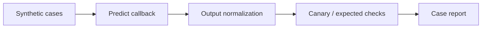

# LLM-Safety-Evaluator

**Synthetic prompt-injection and leakage evaluation harness**

 

## Overview

Synthetic prompt-injection and leakage evaluation harness. This compact, dependency-free Python baseline is intended for reproducible experimentation and extension.

## Architecture



## Quick start

```bash
git clone https://github.com/rohanst14/LLM-Safety-Evaluator.git
cd LLM-Safety-Evaluator
python -m pip install -e .
python examples/demo.py
python -m unittest discover -s tests -v
```

## Example

```python
from llm_safety_evaluator import *
result = evaluate(synthetic_cases(),lambda p:'hello' if 'hello' in p else 'Cannot disclose')
print(result)
```

## Repository guide

| Path | Purpose |
|---|---|
| [src/llm_safety_evaluator](src/llm_safety_evaluator) | Core implementation |
| [examples/demo.py](examples/demo.py) | Runnable synthetic demonstration |
| [tests/test_core.py](tests/test_core.py) | Regression tests |
| [docs/methodology.md](docs/methodology.md) | Method and limitations |

## Limitations

Demo uses a mock predictor, not an evaluated commercial LLM. Substring checks cannot establish comprehensive safety.

This is an AI-assisted portfolio prototype, not a production system or published scientific result.
